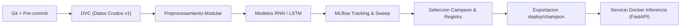

# Prediccion de Series de Tiempo - Beijing PM2.5

[](https://github.com/USUARIO/REPO/actions/workflows/ci.yml)

Forecasting de la concentracion horaria de material particulado PM2.5 en Beijing a 1 hora hacia el futuro utilizando redes recurrentes RNN y LSTM en PyTorch.
El proyecto implementa un flujo completo de MLOps con control de versiones de datos y modelos, seguimiento de experimentos con MLflow, y empaquetado para despliegue en contenedores Docker.
Todo el desarrollo sigue practicas de ingenieria de software profesional con verificacion continua mediante pre-commit y GitHub Actions.

## Pipeline de MLOps



## Estructura del Repositorio

```text
.
├── .github/workflows/      # Flujo de Integracion Continua (CI) en GitHub Actions
├── data/
│   ├── raw/                # Datos crudos de Beijing PM2.5 (.dvc y .gitignore)
│   └── processed/          # Dataset procesado, escalador y metadatos (.dvc y .gitignore)
├── deploy/
│   └── champion/           # Artefactos ligeros versionados en Git para inferencia
├── docker/
│   ├── Dockerfile.mlflow   # Servidor de tracking de MLflow
│   ├── Dockerfile.train    # Entorno de entrenamiento con aceleracion GPU
│   └── Dockerfile.inference# API REST de inferencia optimizada para CPU
├── examples/               # Peticion de ejemplo (sample_request.json)
├── notebooks/              # Analisis exploratorio inicial
├── src/
│   ├── data/               # Descarga, extraccion de caracteristicas y preprocesamiento
│   ├── inference/          # Servidor FastAPI, predictor y esquemas Pydantic v2
│   ├── models/             # Arquitecturas RNN y LSTM con PyTorch
│   └── training/           # Entrenamiento, barrido de semillas y seleccion de campeon
├── tests/                  # Suite de pruebas unitarias y de paridad
├── docker-compose.yml      # Orquestacion de servicios (mlflow, train, inference)
├── dvc.yaml                # Pipeline reproducible de DVC
└── params.yaml             # Parametros centrales de configuracion
```

## Como Reproducir

### 1. Entorno Virtual
Crear y activar un entorno virtual con Python 3.10 e instalar dependencias:
```bash
python -m venv .venv
# En Windows (PowerShell):
.\.venv\Scripts\Activate.ps1
# En Linux/macOS:
source .venv/bin/activate

pip install --no-cache-dir torch==2.14.1 --extra-index-url https://download.pytorch.org/whl/cpu
pip install -r requirements.txt
pre-commit install
```
> [!NOTE]
> Los commits deben realizarse con el entorno virtual activo, ya que el hook local de pre-commit ejecuta pytest utilizando el interprete del PATH.

### 2. Descarga y Preprocesamiento de Datos
Para descargar los datos y procesarlos de forma reproducible:
```bash
python -m src.data.download
python src/data/preprocess.py
```
Tambien puede reproducirse el pipeline con DVC si se tiene configurado el almacenamiento:
```bash
dvc repro
```

### 3. Pruebas Unitarias
Ejecutar la suite completa de 13 pruebas:
```bash
pytest -v
```

### 4. Entrenamiento Local y Barrido con MLflow
Entrenar un modelo individual:
```bash
python -m src.training.train --model lstm
```
Ejecutar el barrido de hiperparametros con multiples semillas:
```bash
python -m src.training.sweep
python -m src.training.summarize
```
Para explorar las metricas y graficas en la interfaz de MLflow:
```bash
mlflow ui --backend-store-uri sqlite:///mlflow.db --port 5000
```

### 5. Registro y Exportacion del Campeon
Identificar la mejor arquitectura, registrarla en el Model Registry con el alias champion y exportar los pesos a `deploy/champion/`:
```bash
python -m src.training.select_best
python -m src.training.verify_champion
python -m src.training.export_champion
```

### 6. Entrenamiento en Docker con GPU
Construir las imagenes de entrenamiento y ejecutar el contenedor:
- En PowerShell:
  ```powershell
  docker compose build
  $env:GIT_COMMIT=(git rev-parse --short HEAD); docker compose run --rm train
  ```
- En Bash / Linux:
  ```bash
  docker compose build
  GIT_COMMIT=$(git rev-parse --short HEAD) docker compose run --rm train
  ```

### 7. Servicio de Inferencia (API REST)
Levantar el servicio de inferencia en segundo plano:
```bash
docker compose up -d inference
```
Endpoints disponibles:
- `GET http://localhost:8000/health`: estado de disponibilidad del servicio (`{"status": "ok"}`).
- `GET http://localhost:8000/info`: metadatos del modelo, horizonte (1h), ventana (24h) y lista de variables.
- `POST http://localhost:8000/predict`: recibe un JSON con 24 registros horarios consecutivos en el campo `records` y devuelve la concentracion predicha de PM2.5.

Ejemplo de consulta con `curl.exe`:
```bash
curl.exe -X POST http://localhost:8000/predict -H "Content-Type: application/json" -d @examples/sample_request.json
```
Ejemplo de consulta con PowerShell:
```powershell
Invoke-RestMethod -Uri http://localhost:8000/predict -Method Post -InFile examples/sample_request.json -ContentType "application/json"
```
Detener el servicio:
```bash
docker compose down
```

## Datos y Versionado

El proyecto utiliza el conjunto de datos **Beijing PM2.5** de UCI Machine Learning Repository (ID 381), compuesto por 43,824 registros horarios registrados entre 2010 y 2014 en la embajada de Estados Unidos en Beijing.

DVC gestiona el versionado del dataset crudo y la etapa de preprocesamiento utilizando un almacenamiento remoto local (`../dvc_storage`). Dado que un clon limpio del repositorio no tendra acceso a este almacenamiento fisico local, no es posible ejecutar `dvc pull` directamente; en su lugar, los datos deben regenerarse ejecutando `python -m src.data.download` seguido de `python src/data/preprocess.py`.

Tags del repositorio:
- `dataset-v1`: Descarga y versionado inicial del archivo crudo con DVC.
- `preprocess-v1`: Etapa de preprocesamiento, generacion de ventanas y escalador.
- `models-v1`: Definicion de arquitecturas RNN y LSTM con PyTorch.
- `train-v1`: Bucle de entrenamiento y registro de metricas en MLflow.
- `sweep-v1`: Barrido de rejilla e iteracion sobre 4 semillas aleatorias.
- `champion-v1`: Registro formal del mejor modelo en MLflow Model Registry y exportacion inicial.
- `docker-train-v1`: Contenerizacion del entrenamiento con soporte CUDA y orquestacion en Docker Compose.
- `inference-v1`: Servicio de inferencia en FastAPI con Docker para CPU y verificacion de paridad.
- `v1.0`: Entrega final, modelo versionado en Git, CI en GitHub Actions y pre-commit con pytest.

## Preprocesamiento

El pipeline de transformacion de datos aplica las siguientes operaciones:
- **Ventana temporal:** Longitud de 24 horas consecutivas para predecir la concentracion de PM2.5 en la hora $t+1$ (horizonte de 1 hora).
- **Variables (15 columnas):** Concentracion de PM2.5, punto de rocio (DEWP), temperatura (TEMP), presion atmosferica (PRES), velocidad acumulada de viento (Iws), horas acumuladas de nieve (Is), horas acumuladas de lluvia (Ir), direccion combinada de viento codificada en one-hot (cbwd: NE, NW, SE, cv), y codificacion ciclica temporal (seno y coseno de la hora del dia y del mes).
- **Division cronologica:** 70% entrenamiento (primeras 30,676 filas), 15% validacion (6,573 filas) y 15% prueba (6,575 filas), respetando la causalidad temporal.
- **Normalizacion:** Ajuste de medias y desviaciones estandar calculado exclusivamente sobre el conjunto de entrenamiento para prevenir fuga de informacion (data leakage).
- **Tratamiento de valores nulos:** Interpolacion lineal solo en vacios de hasta 6 horas consecutivas (`max_interp_gap=6`). Las ventanas que contengan valores nulos restantes son descartadas estrictamente.

## Resultados Empiricos

Todas las metricas de error se reportan desnormalizadas en microgramos por metro cubico ($\mu\text{g/m}^3$):

| Modelo / Configuracion | Val RMSE | Test RMSE | Test MAE |
|---|---|---|---|
| **Persistencia (baseline)** | 22.76 | 19.86 | 10.86 |
| **LSTM (hidden 64, 2 capas, dropout 0.0, 4 semillas)** | **20.81 ± 0.15** | 18.15 ± 0.12 | 10.46 ± 0.12 |
| **LSTM (hidden 64, 1 capa, 4 semillas)** | 20.84 ± 0.08 | 18.20 ± 0.10 | 10.52 ± 0.13 |
| **RNN (hidden 64, 2 capas, dropout 0.2, 4 semillas)** | 20.96 ± 0.03 | 18.30 ± 0.15 | 10.33 ± 0.07 |
| **RNN (hidden 64, 2 capas, dropout 0.0, 4 semillas)** | 21.05 ± 0.07 | 18.44 ± 0.11 | 10.51 ± 0.10 |
| **Modelo Desplegado (`lstm_h64_l2_d0.0_s42`)** | **20.70** | **18.04** | **10.37** |

Ambas arquitecturas superan a la persistencia por cerca de 8% en RMSE; entre ellas la diferencia es pequeña (el LSTM queda algo mejor en RMSE y el RNN algo mejor en MAE) y del orden de la variabilidad entre semillas; los resultados de una sola corrida de la rejilla no son comparables con los de 4 semillas; mayor capacidad (hasta 206 mil parámetros) no mejora el resultado. El criterio de selección usó solo validación; el test se evaluó una vez por run y no intervino en ninguna decisión.

## Pruebas y Aseguramiento de Calidad

El proyecto incluye 13 pruebas automatizadas distribuidas en tres modulos bajo `tests/`:
- `tests/test_preprocess.py`: valida consistencia de formas matriciales, ausencia de NaN o infinitos, no fuga entre particiones y estricto orden temporal.
- `tests/test_models.py`: verifica la consistencia de dimensiones de entrada y salida, ausencia de NaN en pasadas hacia adelante y convergencia minima del gradiente para RNN y LSTM.
- `tests/test_inference.py`: comprueba disponibilidad de endpoints `/health` e `/info`, validacion de esquemas Pydantic v2 (rechazo 422 ante registros incompletos o timestamps no consecutivos), y paridad matematica estricta entre la preparacion de ventanas de inferencia y las matrices de prueba de entrenamiento.

Estas pruebas se ejecutan localmente en cada commit mediante pre-commit y automaticamente en cada actualizacion del repositorio via GitHub Actions.

## Limitaciones y Trabajo Futuro

- **Horizonte de prediccion:** El modelo actual realiza forecasting uniescalon a 1 hora hacia adelante ($t+1$). Una extension natural consiste en incorporar modelos autoregresivos o secuencia a secuencia para prediccion multiescalon (6, 12 y 24 horas).
- **Estacion unica:** Los datos provienen de una estacion puntual en Beijing. Integrar multiples estaciones requeriria arquitecturas espacio-temporales (Graph Neural Networks o ST-GCN).
- **Determinismo en empaquetado:** El hash MD5 del archivo comprimido `dataset.npz` varia ligeramente en funcion de la version de Python y marcas de tiempo del compresor zip, aunque los arreglos numericos internos son 100% identicos.
- **Persistencia de experimentos:** La base de datos SQLite `mlflow.db` y sus artefactos locales no se versionan en Git para mantener el repositorio ligero. En Docker, la persistencia se garantiza mediante el volumen nombrado `mlflow_data`.
